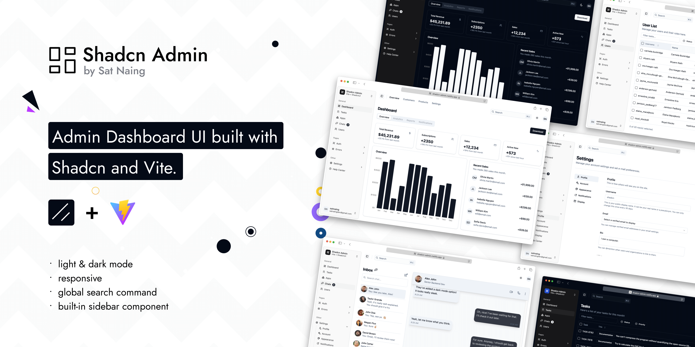

# Shadcn 管理后台

使用 Shadcn 和 Vite 构建的管理后台界面。注重响应式设计和可访问性。



[](https://go.clerk.com/GttUAaK)

我一直在工作中和个人项目中创建管理后台界面。我一直想为未来的项目制作一个可复用的管理后台界面集合，现在它来了。虽然我创建了一些自定义组件，但有些代码直接改编自 ShadcnUI 示例。

> 不过这不是一个启动项目（模板）。我可能会在未来制作一个。

## 特性

- 明暗主题模式
- 响应式设计
- 可访问性支持
- 内置侧边栏组件
- 全局搜索命令
- 10+ 页面
- 额外自定义组件
- RTL（从右到左）支持

<details>
<summary>自定义组件（点击展开）</summary>

本项目使用 Shadcn UI 组件，但其中一些为了更好的 RTL（从右到左）支持和其他改进而略有修改。这些自定义组件与原始 Shadcn UI 版本有所不同。

如果你想使用 Shadcn CLI 更新组件（例如 `npx shadcn@latest add <component>`），对于非自定义组件通常是安全的。对于列出的自定义组件，你可能需要手动合并更改以保留项目的修改，避免覆盖 RTL 支持或其他更新。

> 如果你不需要 RTL 支持，可以通过 Shadcn CLI 安全地更新 'RTL Updated Components'，因为这些更改主要是为了 RTL 兼容性。'Modified Components' 可能有其他需要考虑的自定义。

### 修改过的组件

- scroll-area
- sonner
- separator

### RTL 更新组件

- alert-dialog
- calendar
- command
- dialog
- dropdown-menu
- select
- table
- sheet
- sidebar
- switch

**注意：**

- **Modified Components**：这些组件有一般性更新，可能包括 RTL 调整。
- **RTL Updated Components**：这些组件有针对 RTL 语言支持的特定更改（例如布局、定位）。
- 有关实现细节，请查看 `src/components/ui/` 中的源文件。
- 项目中所有其他 Shadcn UI 组件都是标准的，可以通过 CLI 安全更新。

</details>

## 技术栈

**UI:** [ShadcnUI](https://ui.shadcn.com) (TailwindCSS + RadixUI)

**构建工具:** [Vite](https://vitejs.dev/)

**路由:** [TanStack Router](https://tanstack.com/router/latest)

**类型检查:** [TypeScript](https://www.typescriptlang.org/)

**代码检查/格式化:** [ESLint](https://eslint.org/) & [Prettier](https://prettier.io/)

**图标:** [Lucide Icons](https://lucide.dev/icons/), [Tabler Icons](https://tabler.io/icons)（仅限品牌图标）

**认证（部分）:** [Clerk](https://go.clerk.com/GttUAaK)

## 本地运行

克隆项目

```bash
  git clone https://github.com/satnaing/shadcn-admin.git
```

进入项目目录

```bash
  cd shadcn-admin
```

安装依赖

```bash
  pnpm install
```

启动服务器

```bash
  pnpm run dev
```

## Git 提交规范

本项目使用 [Husky](https://typicode.github.io/husky/) + [lint-staged](https://github.com/okonet/lint-staged) 在 **commit 前**强制执行 ESLint / Prettier。提交信息约定采用 [Conventional Commits](https://www.conventionalcommits.org/)（当前 **未** 接入 commitlint，文案靠约定遵守）。

### 提交前必须满足（由钩子强制）

`git commit` 时会触发 `.husky/pre-commit` → `pnpm lint-staged`，仅检查**暂存区**文件：

| 匹配文件                        | 自动执行                            |
| ------------------------------- | ----------------------------------- |
| `*.{ts,tsx}`                    | `eslint --fix` → `prettier --write` |
| `*.{json,md,css,html,yml,yaml}` | `prettier --write`                  |
| `eslint.config.js`              | `prettier --write`                  |

任一命令失败（例如 ESLint 报错且无法自动修复），提交会被中断。

### ESLint 关键约束（提交前需通过）

配置见 `eslint.config.js`（忽略 `dist`、`src/components/ui`）：

- 禁止 `console`（`no-console: error`）
- 禁止未使用变量；可用 `_` 前缀忽略（`@typescript-eslint/no-unused-vars`）
- 类型导入须使用 `import type` / inline type import（`consistent-type-imports`）
- 禁止同一模块重复 import（`no-duplicate-imports`）
- 遵循 React Hooks / React Refresh / TanStack Query 推荐规则
- 与 Prettier 冲突的格式规则已关闭（`eslint-config-prettier`）

### 提交信息约定（Conventional Commits）

格式：

```text
<type>(可选范围): <简要说明>

[可选正文]

[可选脚注]
```

常用 `type`：

| type       | 含义                     |
| ---------- | ------------------------ |
| `feat`     | 新功能                   |
| `fix`      | 缺陷修复                 |
| `docs`     | 仅文档                   |
| `style`    | 格式/样式（不影响逻辑）  |
| `refactor` | 重构（非 feat/fix）      |
| `perf`     | 性能优化                 |
| `test`     | 测试                     |
| `chore`    | 构建、依赖、工具链等杂项 |
| `ci`       | CI 配置                  |

说明：

- 使用现在时、祈使语气；说明「为什么」优先于堆砌文件列表
- 中英文均可；本仓库近期习惯为中文说明，例如：`fix(auth): 修复 refresh 未解包导致登录态失效`
- 范围（scope）可选，建议与模块对应：`auth`、`users`、`chats`、`dashboard` 等
- 破坏性变更在正文或脚注标明 `BREAKING CHANGE:`

示例：

```bash
git commit -m "feat(chats): 支持会话列表空状态展示"
git commit -m "fix(auth): 修复 refresh 未解包接口响应导致登录态失效"
git commit -m "chore: 升级 eslint 相关依赖"
```

### 推荐提交流程

```bash
# 1. 查看改动
git status
git diff

# 2. 只暂存本次相关文件
git add <files>

# 3. 提交（会自动跑 lint-staged）
git commit -m "fix(auth): 简述原因"

# 4. 确认成功
git status
```

### 钩子安装

`pnpm install` 时通过 `prepare` 脚本自动安装 Husky。若钩子未生效：

```bash
pnpm run prepare
```

请在**本仓库根目录**（`Unibox-admin`）执行 git 操作，确保能读到 `.husky/pre-commit`。

### 跳过钩子（不推荐）

仅紧急热修等场景可临时跳过；**合并进主分支前仍须保证 lint 通过**：

```bash
git commit --no-verify -m "你的提交信息"
```

### 手动检查（不依赖 commit）

```bash
pnpm lint          # ESLint
pnpm lint:fix     # ESLint 自动修复
pnpm format:check  # Prettier 检查
pnpm format        # Prettier 写回
```

## 赞助项目 ❤️

如果你发现这个项目对你有帮助，或者在你自己的工作中使用它，请考虑[赞助我](https://github.com/sponsors/satnaing)来支持开发和维护。你也可以[请我喝杯咖啡](https://buymeacoffee.com/satnaing)。不用担心，每一分钱都有帮助。谢谢！🙏

如有问题或赞助咨询，欢迎通过 [satnaingdev@gmail.com](mailto:satnaingdev@gmail.com) 联系。

### 当前赞助商

- [Clerk](https://go.clerk.com/GttUAaK) - 现代 Web 的认证和用户管理

## 作者

由 [@satnaing](https://github.com/satnaing) 用 🤍 精心制作

## 许可证

根据 [MIT License](https://choosealicense.com/licenses/mit/) 授权
